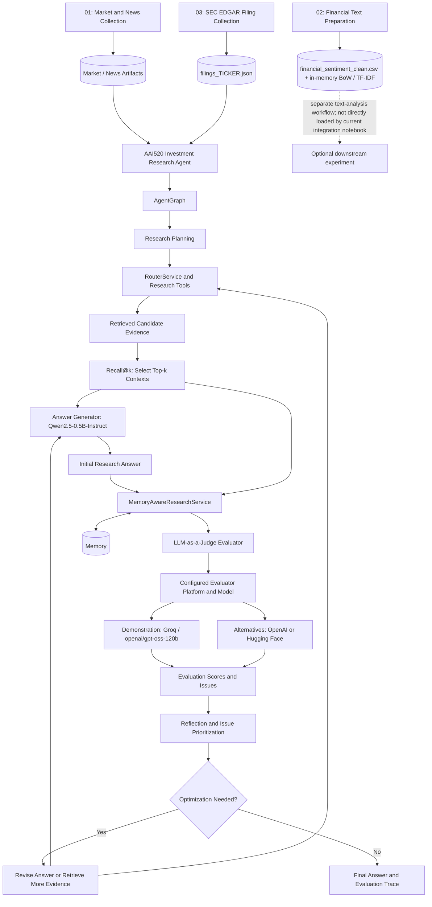

# System Architecture — AAI-520 Autonomous Investment Research Agent

## 1. Purpose and scope

The AAI-520 Autonomous Investment Research Agent is an end-to-end research workflow that combines market/news data collection, financial-text preparation, evidence-based answer generation, and an evaluator–optimizer loop. The implementation is organized as a Python source package under `src/` and a sequential notebook workflow under `notebooks/`.

This document describes the implemented responsibilities and the main runtime handoffs. It intentionally distinguishes implemented application components from external data/model dependencies and notebook orchestration. It does not treat every possible research capability as implemented merely because it could fit the architecture.

## 2. High-level architecture



The notebooks provide data-preparation and execution steps. Notebook 02 creates a separate cleaned financial-sentiment dataset and in-memory BoW/TF-IDF features; these are not currently consumed by the integration notebook. The live integrated path loads market, news, and SEC filing artifacts, then uses the Python package for research, evidence processing, generation, routing, evaluation, optimization, and memory. The final notebook coordinates the research run and subsequent evaluation/optimization handoff.

## 3. Notebook workflow

Run the notebooks from the repository root. The recommended sequence is market/news collection, financial-text preparation, SEC filing collection, and then the integrated research notebook. Notebook 02 is a complementary preparation experiment; the current integrated notebook does not directly consume its cleaned CSV or vectorizer matrices.

### 3.1 `notebooks/01_market_news_collection.ipynb`

**Responsibility:** Collect the market-history and company/news information used by the research workflow, according to the configured ticker, period, and data-provider credentials.

**Expected result:** Data previews and collection status in the notebook, plus the data artifacts written by its cells for later stages. Check the notebook's output paths and record counts rather than assuming that a particular artifact was produced when a provider call fails or returns no records.

### 3.2 `notebooks/02_financial_text_preparation.ipynb`

**Responsibility:** Download the `sbhatti/financial-sentiment-analysis` dataset with `kagglehub`, validate `Sentence`/`Sentiment`, remove missing and duplicate rows, normalize labels, clean text, and encode sentiment as -1/0/1. It writes `data/processed/financial_sentiment_clean.csv`.

The notebook then performs a stratified 80/20 train/test split (`random_state=42`) and builds unigram/bigram Bag-of-Words and TF-IDF matrices with up to 5,000 features. The vectorizers and matrices are held in memory rather than persisted.

**Integration boundary:** The current integrated research notebook does not load `financial_sentiment_clean.csv` or use these BoW/TF-IDF matrices. This is a separate financial-text preparation/experimentation path; the integrated notebook's own prompt-chain preprocessing is performed by `process_evidence()` within `AgentGraph.run()`.

### 3.3 `notebooks/03_filings_collection.ipynb`

**Responsibility:** Collect SEC EDGAR filing evidence through `NotebookResearchProvider.filings()`. The adapter resolves the ticker to a CIK, requests the SEC submissions index, and downloads bounded primary-document text for recent annual, quarterly, current, and selected foreign-issuer filing types. The query can be narrowed to form types such as `10-K` and `10-Q`.

**Artifact and contract:** The notebook writes `data/processed/filings_<TICKER>.json` with the ticker, collection timestamp, source label, and serialized `EvidenceRecord` objects. Records preserve source/title/date/ticker, filing URL and document/accession identifier, plus a bounded text excerpt. The integration notebook loads the JSON `filings` array, validates each row as an `EvidenceRecord`, and passes the records into `NotebookResearchProvider` with the market and news data.

Set `SEC_USER_AGENT` to a descriptive application name and real contact address, keep request rates reasonable, and verify filing URLs and empty-result warnings. The artifact is required by the current integration notebook.

### 3.4 `notebooks/AAI520_Investment_Research_Agent.ipynb`

**Responsibility:** Load `market_<TICKER>.csv`, `news_<TICKER>.json`, and `filings_<TICKER>.json`; construct `NotebookResearchProvider` with market, news, and filing evidence; run `AgentGraph`; inspect its research plan and processed evidence; and pass the initial answer/context plus the graph-owned `RouterService` into the evaluator–optimizer workflow.

**Expected result:** The research question and company context, retrieved evidence/context, initial answer, evaluation findings, reflection/optimization activity, and final response or evaluation trace, as exposed by the notebook's output cells.

The notebook is the main end-to-end entry point. In the current version, it requires the market/news and filing artifacts. Notebook 02 is not a direct input to this execution path.

## 4. Runtime component responsibilities (`src/`)

The sections below describe the main responsibilities reflected by the current implementation history. Exact module paths and class names should be kept aligned with the source tree when code is refactored.

### 4.1 Research graph and state

**`AgentGraph`** is the entry point for the research graph. It coordinates the research workflow and provides access to the `RouterService` through its router-service accessor. The graph produces the initial draft/report and exposes associated metadata, including research context where available.

The graph and its state are responsible for coordinating research steps, not for owning the evaluator's scoring rubric. Keeping this boundary allows the research workflow to be exercised separately from the optimization loop.

### 4.2 Planning and routing

Planning converts the research request into work that can be executed by the research workflow. Routing directs each research operation to the appropriate provider or tool.

**`RouterService`** is the shared routing capability used by the research graph and by the evaluator–optimizer when additional research is needed. Reusing this service avoids a second, inconsistent routing implementation and keeps follow-up retrieval aligned with the initial research path.

Provider availability and the specific data returned depend on the configured source integrations and their successful execution. Do not assume a tool is active solely because it appears in a conceptual plan.

### 4.3 Evidence and answer generation

The research workflow combines available provider output into a context used by the answer generator. The answer generator produces the initial answer/report from the research request and that context.

The implementation can use a configured local Hugging Face model where dependencies and model files are available. Where the implementation provides a fallback path, the workflow may generate a deterministic evidence-oriented response if local model loading is unavailable. The fallback should not be interpreted as equivalent to a full language model.

The evidence context is passed forward with the initial answer so that evaluation can judge the response against the information actually supplied to it.

### 4.4 Evaluator–optimizer orchestration

**`MemoryAwareResearchService`** coordinates the evaluation/optimization workflow and supports a handoff using an already-generated answer. Its `run_with_initial_answer()` path allows the final notebook to pass in the initial report and context instead of unnecessarily restarting the entire research graph.

The service accepts the configured data-provider and answer-generator dependencies. If the enriched context is empty, the implementation can fall back to `AgentGraph.run()` to obtain research output, including the draft report and available context metadata. This makes the initial-answer handoff and the fallback research path explicit.

The evaluation/optimization cycle is:

1. **Evaluate:** assess the answer against the question and supplied context using the configured evaluator.
2. **Reflect:** interpret evaluation results and identify actionable deficiencies.
3. **Prioritize:** classify or rank issues using the implementation's configured issue and severity rules.
4. **Optimize:** revise the response and, where the orchestration determines more evidence is needed, use the shared router/research capability.
5. **Re-evaluate:** check the revised response under the same evaluation setup.
6. **Stop and record:** finish when the acceptance criteria are satisfied or the configured iteration limit is reached; retain the available result and trace.

Exact metric names, score ranges, thresholds, issue-severity mappings, and stop conditions are implementation/configuration details. They must be documented from the evaluator and configuration code, not inferred from the architecture diagram.

### 4.5 Evaluation and issue severity

The evaluator produces quality signals for the current response according to the active evaluator implementation. The reflection stage turns those signals into issues or improvement suggestions. Severity and optimization decisions are based on the configured mapping and thresholds.

An evaluator score is a rubric result, not automatically a calibrated probability or guarantee of factual correctness. Interpret it together with the score definition, evaluator comments, retrieved context, and initial/final answer comparison.

### 4.6 Memory

The memory subsystem supports retention and retrieval of useful workflow/evaluation information, as implemented by its memory models, cache/repository, and serialization components. The memory-aware service integrates this capability with the research/evaluation workflow.

Memory is supporting context and traceability; it does not replace evidence retrieval or prove that a generated claim is correct. Persistence behavior depends on the configured repository and runtime settings.

### 4.7 Configuration and logging

Configuration is centralized where supported by the application configuration module and environment file. `.env.example` documents the variable names expected by the repository; `.env` supplies machine-specific values and must not be committed.

The evaluator configuration uses these environment variables:

| Variable | Purpose | Configuration guidance |
|---|---|---|
| `GROQ_API_KEY` | Credentials for the Groq evaluator interface | Required when Groq is the selected evaluator provider |
| `OPENAI_API_KEY` | Credentials for the OpenAI evaluator interface | Required when OpenAI is the selected evaluator provider |
| `EVALUATOR_MODEL` | Evaluator model identifier | Defaults to `gpt-5.4-mini`; override it to select another supported evaluator model, such as `openai/gpt-oss-120b` for the demonstrated Groq setup |

Set the API key that corresponds to the selected provider and keep it in the local `.env` file. The supported Hugging Face evaluator option may use `HF_TOKEN` where model access requires it. Provider/model compatibility and credentials must be validated for the chosen configuration.

Logging is configured through the project's logging configuration and component loggers. Logs help trace execution stages and diagnose data-source, model-loading, routing, evaluation, and optimization failures. Use the configured log level and output destination; do not assume a log filename or directory unless it is defined in the checked-out configuration. Secrets must not be written to logs.

## 4.8 Separate answer-generation and evaluation models

The workflow uses distinct model roles for producing an answer and judging its quality.

### Answer generation

The configured local generation path uses `Qwen/Qwen2.5-0.5B-Instruct` through Hugging Face Transformers, where model files and dependencies are available. It consumes the research question and the evidence/context assembled by the research workflow to generate the initial answer and requested revisions. CPU inference may be slow, and model capacity can affect response quality.

### Recall@k evidence selection

Before generation, the retrieval strategy selects the **top-*k* contexts** ranked as relevant to the research question and supplies those contexts as evidence to the answer generator. The parameter *k* determines how many retrieved contexts are included. Increasing *k* can improve evidence coverage but may also add irrelevant material, increase prompt size, and raise latency.

Recall@k can refer to a retrieval evaluation metric that measures the proportion of relevant items found among the top-*k* results. The exact calculation depends on the implementation's relevance labels and ground-truth set. Therefore, the use of top-*k* contexts as generation evidence and a numeric Recall@k score are related but distinct claims: document the selection behavior from the retrieval code, and report a measured recall score only when its calculation and evaluation data are available.

### Evaluation and platform flexibility

The evaluator is a separate, configurable LLM-as-a-Judge. The implementation supports choosing an evaluator model through **Groq, OpenAI, or Hugging Face**, subject to the selected provider's model availability, credentials, API compatibility, and structured-output support. The project's demonstration uses **Groq with `openai/gpt-oss-120b`** as the evaluation model.

The evaluator receives the question, candidate answer, relevant evidence/context, and configured rubric. It returns evaluation findings—such as scores, issues, or recommendations—which are used by reflection and optimization. The answer generator and evaluator are separate roles so that judging does not depend solely on the generator's self-assessment. This separation may reduce some self-evaluation bias but does not guarantee that the evaluator is unbiased or factually correct.

Model IDs and provider settings should be configured independently for generation and evaluation. `HF_MODEL` configures answer generation, while `EVALUATOR_MODEL` selects the evaluator and defaults to `gpt-5.4-mini`. Supply `GROQ_API_KEY` or `OPENAI_API_KEY` for the corresponding evaluator interface; Hugging Face may require `HF_TOKEN`. The Groq demonstration can override `EVALUATOR_MODEL` to `openai/gpt-oss-120b`. Logging should identify the selected model role and workflow stage where useful, while never recording API keys or other secrets. Tests should cover provider configuration, evaluator input/output validation, top-*k* context selection, and the evaluation/optimization handoff.

## 5. Data and control flow

The key runtime handoff is. The generator and evaluator are distinct model roles, and Recall@k selects the top-*k* retrieved contexts supplied as evidence to answer generation:

1. The final notebook sets up the research question and company/ticker context.
2. `AgentGraph` coordinates planning, routing, retrieval, context construction, and initial answer/report generation.
3. The notebook passes the initial answer and available research context to `MemoryAwareResearchService.run_with_initial_answer()`.
4. The evaluator assesses the answer against the query and context.
5. Reflection identifies issues; optimization either improves the response or triggers further research through the shared `RouterService` where supported.
6. The revised response is re-evaluated until the stopping condition or iteration limit is reached.
7. The notebook displays the final answer and available evaluation/optimization trace.

The exact fields in the graph state and result objects should be read from their dataclass/model definitions and the final notebook. This architecture document does not prescribe additional state fields that are not present in the code.

## 6. Configuration and external dependencies

The workflow may depend on:

- market-data and news providers used by notebook 01;
- dataset access required by financial-text preparation in notebook 02;
- SEC EDGAR submissions and filing-document endpoints used by notebook 03;
- Hugging Face model identifiers, model files, and access credentials when needed;
- local environment variables documented by `.env.example`.

External data may be missing, delayed, rate-limited, or inconsistent. SEC EDGAR requests require a descriptive `SEC_USER_AGENT` with a real contact address and should be made at reasonable rates. Local model loading may require a first-time download and adequate disk space; CPU generation can be slow. A workflow completing without an exception does not guarantee that every data source returned useful records.

## 7. Observability, evaluation, and reproducibility

For each run, review the query and ticker, source/context availability, initial answer, evaluator output, issues identified, optimization actions, iteration count, final answer, and any memory/trace information emitted by the notebook.

For meaningful baseline-versus-optimized comparisons:

- hold the query, ticker, source context, and evaluation configuration constant;
- record initial and final evaluation results using the same rubric;
- review evaluator comments and evidence alongside numerical scores;
- report missing sources, model fallback use, and execution errors;
- do not equate more verbose output with improved quality.

Run unit tests from the repository root using the command documented in the README/project setup, for example:

```bash
uv run pytest -q
```

Unit tests and a complete live notebook execution validate different things. End-to-end execution also depends on credentials, external services, downloaded data, and model availability.

## 8. Known limitations and maintenance notes

- The architecture is an academic prototype, not a production trading or financial-advice system.
- Data quality depends on upstream sources, dates, provider access, and collection success.
- LLM-based evaluation is itself fallible and must be interpreted alongside evidence and the scoring rubric.
- The local-model and fallback paths may produce responses of different quality.
- The final notebook's displayed tables and output fields are the most direct guide to the result schema; update this document whenever those schemas or service handoffs change.

