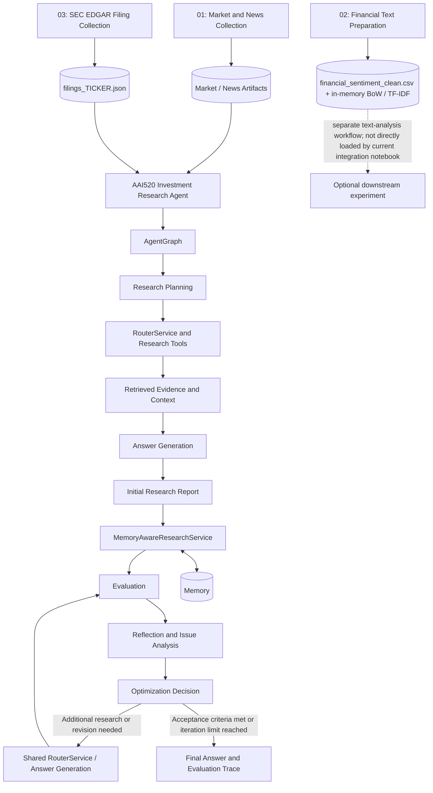
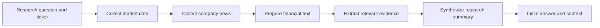
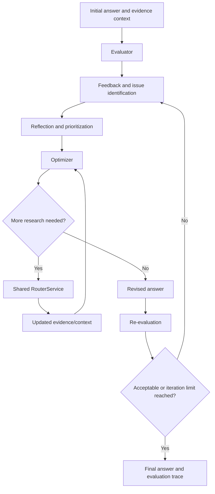

# AAI-520 Autonomous Investment Research Agent
## Draft Implementation and Evidence Report

**Status:** Draft for team review  
**Project:** AAI-520 Autonomous Investment Research Agent  
**Purpose:** Summarize the target agent capabilities, the two required workflows, how these map to the current implementation structure, the evidence that should be collected to substantiate implementation, and the planned division of work across the team.

> **Evidence note:** This report is based on the project README and architecture drafts, the implementation details discussed during project development, and the agreed cohort/workflow plan. It is not a fresh, source-by-source audit of the live GitHub `main` branch. Where an implementation claim needs confirmation, the report identifies the source or runtime artifact that should be checked rather than presenting an unverified claim as proven.

---

## 1. Executive summary

The project aims to implement an autonomous investment research agent that takes a company-focused question, gathers relevant financial and news information, organizes evidence, generates a research response, evaluates that response, and improves it through reflection and bounded optimization. The system also retains useful memory or evaluation information where supported by the configured implementation.

The final goal is not simply to generate a financial summary. It is to demonstrate an integrated agent workflow with four core functions:

1. **Research planning** — decompose a user request into manageable research tasks.
2. **Dynamic tool and data use** — route tasks to appropriate research capabilities and build an evidence context.
3. **Self-evaluation and reflection** — evaluate the generated answer, identify deficiencies, and guide improvement.
4. **Memory and learning across runs** — preserve and reuse relevant information or evaluation traces where the configured memory implementation supports it.

These functions are demonstrated through two complementary workflows:

- **Prompt Chaining:** a staged transformation from source information to a structured research summary.
- **Evaluator–Optimizer:** a feedback loop that evaluates an initial answer, identifies issues, revises or augments the answer, and evaluates it again.

The current documented implementation boundary centers on `AgentGraph`, the shared `RouterService`, evidence/context construction, answer generation, and `MemoryAwareResearchService.run_with_initial_answer()`. The integrated notebook connects the initial research response to the evaluator–optimizer path. Final evidence should combine source-level inspection, successful tests, and notebook execution outputs.

### End-to-end architecture diagram



## 2. Project goal and success criteria

The project should demonstrate a traceable research process, not just a fluent generated response. A successful end-to-end run should make it possible to identify:

- the user question and company/ticker under investigation;
- the research tasks selected or planned;
- the tools/data sources invoked and the information retrieved;
- the evidence/context supplied to answer generation;
- the initial answer;
- the evaluation dimensions, findings, and issues;
- any reflection, optimization, or additional research performed;
- the re-evaluation results and stopping reason;
- the final answer and any memory/trace information emitted by the implementation.

The system should also be testable in smaller units. Where external APIs, data downloads, or local model inference are not needed, tests should use controlled inputs or injected dependencies so core orchestration behavior can be validated reproducibly.

## 3. Four core agent functions and implementation mapping

### 3.1 Function 1 — Research planning

**Purpose**

Convert a broad investment research question into a structured set of tasks. For example, a company question may require market performance, financial information, relevant news, risk factors, and a concise synthesis.

**Implementation mapping**

- The research graph is coordinated through `AgentGraph`.
- Planning and state/routing components represent the research request and the tasks to be executed.
- The final research notebook acts as the user-facing execution entry point for the integrated workflow.

**Evidence to collect**

1. Source references for the planner and graph classes under `src/`.
2. A unit test showing a representative research request is transformed into a plan or routed research tasks.
3. A notebook output showing the question/ticker and the planned or executed research stages, where exposed by the current notebook.
4. A trace/log excerpt showing the planned workflow or stage transitions, with secrets and sensitive data removed.

**Acceptance check**

The plan should be related to the user's research question and should lead to executable research actions. If planning is implicit in the graph rather than emitted as a separate plan object, document that implementation choice and use the graph state/trace as evidence.

### 3.2 Function 2 — Dynamic tool and data use

**Purpose**

Select and invoke appropriate research capabilities instead of relying on a fixed, unsupported answer. The system should use available market/news or other configured research sources, combine returned material into context, and preserve the distinction between retrieved evidence and generated interpretation.

**Implementation mapping**

- `RouterService` is the shared routing capability.
- `AgentGraph` uses the research routing path to collect evidence and construct context for the initial answer.
- The evaluator–optimizer can reuse the shared routing/research capability when additional evidence is needed.
- Notebook 01 collects market/news data; notebook 02 cleans and vectorizes a financial-sentiment dataset for separate text-analysis experiments; notebook 03 collects SEC EDGAR filings; the integration notebook directly loads market, news, and filing artifacts. The current integration notebook does not load notebook 02's `financial_sentiment_clean.csv` or its in-memory vectorizer matrices.

**Evidence to collect**

1. Source references for `RouterService`, provider/tool adapters, and context/evidence construction under `src/`.
2. Tests showing a research request is routed to an appropriate tool/provider and that returned data is passed forward.
3. Notebook output or saved artifacts demonstrating that the collection stage returned records for the selected ticker/date range.
4. A trace connecting retrieved context to the initial answer and, if applicable, to follow-up research.
5. Error/empty-result handling evidence for unavailable sources, if tests or notebook output cover it.

**Acceptance check**

The response context should be based on actual returned data. The architecture should not imply that every source or specialist is active unless the checked-out code invokes it. Record missing, empty, delayed, or failed provider responses as limitations.

### 3.3 Function 3 — Self-evaluation and reflection

**Purpose**

Assess whether the generated answer is relevant, supported by the supplied evidence, sufficiently complete, and appropriately handles uncertainty or insufficient information. Reflection converts evaluation results into actionable improvement work.

**Implementation mapping**

- The evaluator–optimizer components under `src/` evaluate the initial or revised answer.
- Reflection and issue analysis interpret evaluation findings and identify deficiencies.
- Optimization applies revisions or triggers further research where the orchestration supports it.
- `MemoryAwareResearchService.run_with_initial_answer()` allows the existing initial answer and research context to enter the evaluation/optimization workflow without necessarily restarting the research graph.
- Re-evaluation checks the revised answer against the configured criteria.

**Evidence to collect**

1. Source references for evaluator, reflection, optimization, and orchestration classes.
2. Tests for score interpretation, issue identification/severity, stop conditions, and iteration limits where implemented.
3. A captured initial-versus-final answer comparison.
4. Evaluation output showing the score/rating, issue details, and evaluator comments for both initial and final responses when available.
5. A trace showing why the optimizer revised the answer, requested additional research, or stopped.

**Acceptance check**

The report should state the actual evaluation rubric and score range used by the implementation. Scores are not automatically probabilities or guarantees of factual correctness. Improvement should be substantiated by the same evaluation setup and by reviewing evidence, comments, and answer changes—not merely by a longer final response.

### 3.4 Function 4 — Memory and learning across runs

**Purpose**

Retain useful information from research or evaluation so the system can reuse relevant context, preserve a trace of prior decisions, or support subsequent runs. Memory should support research and traceability; it should not be treated as a substitute for fresh evidence.

**Implementation mapping**

- Memory models and persistence/repository components live under the evaluator–optimizer/memory part of `src/`, as present in the checked-out tree.
- `MemoryAwareResearchService` integrates memory with research/evaluation orchestration.
- The architecture describes memory as supporting context and traceability; exact persistence and retrieval behavior is implementation-dependent.

**Evidence to collect**

1. Source references for memory domain models and repository/cache/serialization components.
2. Unit tests for memory serialization/deserialization and disk read/write, if those behaviors are in the current implementation.
3. A test or controlled demonstration showing stored memory can be retrieved in a later operation.
4. Notebook/log output showing a memory operation or evaluation trace, if exposed.
5. A description of what is stored, how it is retrieved, and how stale or irrelevant memory is handled.

**Acceptance check**

Only claim cross-run learning if the implementation actually persists and retrieves information across separate runs. If memory is limited to in-run state or an evaluation trace, describe it accurately as such rather than implying model training or automatic learning.

---

## Model Strategy: Separate Answer Generation and Evaluation

The implementation separates answer generation from answer evaluation through two distinct model roles. This separation allows the generation and judging components to be selected, configured, and assessed according to their different responsibilities.

### Answer-generation model: Qwen2.5-0.5B-Instruct

The answer-generation component uses `Qwen/Qwen2.5-0.5B-Instruct` through the project's local Hugging Face Transformers integration, where the model files and dependencies are available.

Its responsibilities are to:

- Consume the research question and retrieved evidence/context.
- Generate the initial investment research answer.
- Produce revisions when the optimization workflow requests improvements.
- Incorporate additional evidence retrieved through the shared research routing service, where applicable.

The model's relatively small size supports local experimentation and avoids requiring a hosted generation API. However, limited model capacity and CPU inference latency should be considered when interpreting response quality and runtime.

### Evidence selection with Recall@k

Answer generation uses a **Recall@k retrieval strategy** to select the top-*k* contexts as evidence for the answer. The retrieval stage ranks candidate contexts against the research query and passes the selected top-*k* contexts into the generation workflow.

The intention is to improve evidence coverage: relevant information should be retrieved before the answer is generated, reducing the chance that important supporting context is omitted. The selected contexts are evidence inputs, not a guarantee that every generated claim is correct.

The parameter *k* controls the number of contexts supplied. A smaller *k* limits context size and can reduce noise, while a larger *k* may increase coverage at the cost of additional context, latency, and potentially less relevant material. The value of *k* should therefore be configured or documented according to the implementation, and retrieval quality should be evaluated against relevant evidence.

Recall@k is also a retrieval evaluation measure: it generally measures how much of the relevant evidence set is retrieved within the top *k* results. The implementation's exact formula and ground-truth definition should be followed when reporting a numeric metric. The use of top-*k* contexts for generation should not, by itself, be presented as proof that a measured recall score has improved.

### Evaluation model: configurable LLM-as-a-Judge

The evaluation component supports selecting a chat-capable evaluator model through one of the supported platforms:

- **Groq**
- **OpenAI**
- **Hugging Face**

The project demonstration uses the **Groq platform with `openai/gpt-oss-120b`** as the evaluator model. This is the demonstrated configuration; other supported platforms/models can be selected through the evaluator's configuration, subject to provider availability, credentials, API compatibility, and structured-output requirements.

#### Evaluator environment settings

Configure the evaluator in the local `.env` file using the settings below:

| Variable | Purpose | When to set it |
|---|---|---|
| `GROQ_API_KEY` | API credential for the Groq evaluator interface | Required when Groq is selected |
| `OPENAI_API_KEY` | API credential for the OpenAI evaluator interface | Required when OpenAI is selected |
| `EVALUATOR_MODEL` | Model identifier used by the evaluator | Defaults to `gpt-5.4-mini`; override it for another supported model, such as `openai/gpt-oss-120b` in the Groq demonstration |

Use the key for the selected provider rather than assuming both provider keys are required. The Hugging Face evaluator option may require `HF_TOKEN`, depending on model access. Keep credentials out of source control and logs. A configured model identifier must also be supported by the chosen provider.

The evaluator receives the research question, generated answer, relevant evidence/context, and configured evaluation rubric. It assesses the response using the dimensions supported by the implementation—for example, relevance, evidence-groundedness, completeness, and handling of insufficient evidence—and returns evaluation findings such as scores, issues, and improvement recommendations.

A distinct evaluator is preferred for three reasons:

1. **Functional specialization:** the generator creates a useful research response, while the evaluator applies a defined quality rubric.
2. **Reduced dependence on self-judgment:** a separate model provides an independent assessment rather than asking the generator to judge its own output. This can reduce some self-evaluation bias, but it does not guarantee unbiased or correct scoring.
3. **Independent optimization signals:** evaluation findings can guide reflection, issue prioritization, further research, and response revision without coupling the judging logic to the generation model.

### Integration with the evaluator–optimizer workflow

The research graph generates the initial answer and makes the associated evidence/context available to `MemoryAwareResearchService.run_with_initial_answer()`. The evaluation service invokes the configured judge model, reflection interprets the findings, and optimization revises the answer or requests additional research when supported by the workflow. The revised answer is evaluated again, subject to configured stopping criteria and iteration limits.

The evaluator's score is a rubric-based quality signal, not automatically a probability of correctness. Results must be interpreted alongside the rubric, retrieved evidence, evaluator comments, and differences between the initial and final responses.

### Evidence required to substantiate the model strategy

The implementation should be substantiated with:

- Source references showing the answer generator and evaluator use distinct model roles/configurations.
- Configuration evidence showing the effective generation model and evaluator platform/model.
- A successful generation example using the configured answer model.
- A successful structured evaluation result from the demonstrated Groq `openai/gpt-oss-120b` configuration.
- Tests confirming the evaluator receives the intended question, answer, evidence/context, and rubric.
- Retrieval evidence showing which top-*k* contexts were selected for answer generation, including the configured *k* value.
- Where a numeric Recall@k score is reported, the formula, relevance ground truth, and evaluation dataset or test case used to calculate it.
- An initial-versus-final answer comparison showing evaluation and optimization activity.

The Groq demonstration should be distinguished from the evaluator's broader platform support. A platform/model should only be described as tested when the relevant configuration and invocation have been exercised successfully.

## 4. Two workflows to be demonstrated

### Workflow diagrams

#### Prompt Chaining



#### Evaluator–Optimizer



### 4.1 Workflow A — Prompt Chaining

**Target sequence**

```text
Company / research question
          |
          v
Collect financial and market information
          |
          v
Collect relevant news
          |
          v
Preprocess and classify available text
          |
          v
Extract relevant facts and risks
          |
          v
Synthesize a structured research summary
```

The intended conceptual chain is **News → Preprocess → Classify → Extract → Summarize**, supported by market/financial information and the research question. The precise operations available in the final integrated notebook should be described according to the actual source and cell execution path.

**Notebook mapping**

| Notebook | Role in the workflow | Evidence expected after execution |
|---|---|---|
| `notebooks/01_market_news_collection.ipynb` | Collect market history and company-related news | Collection status, previews/counts, date/ticker details, and artifacts actually written |
| `notebooks/02_financial_text_preparation.ipynb` | Download, validate, clean, label, and vectorize the financial-sentiment dataset | Dataset counts, cleaned rows, `data/processed/financial_sentiment_clean.csv`, and BoW/TF-IDF train/test matrix shapes |
| `notebooks/03_filings_collection.ipynb` | Resolve ticker to SEC CIK; collect recent annual, quarterly, current, and selected foreign-issuer filing evidence through `NotebookResearchProvider.filings()` | Filing counts/previews, source URLs, filing dates/form identifiers, and `data/processed/filings_<TICKER>.json` |
| `notebooks/AAI520_Investment_Research_Agent.ipynb` | Load market/news/filing artifacts; run `AgentGraph`; hand off initial answer/context and shared router to evaluator–optimizer | Research plan, retrieved/processed evidence, initial response/report, evaluation/optimization trace, and final workflow outputs |

**Financial-text preparation and integration boundary**

Notebook 02 uses `kagglehub` to download `sbhatti/financial-sentiment-analysis`, requires `Sentence` and `Sentiment` columns, drops missing/duplicate rows, normalizes labels, cleans text, and encodes sentiment (`negative = -1`, `neutral = 0`, `positive = 1`). It writes `data/processed/financial_sentiment_clean.csv`. It then performs a stratified 80/20 train/test split with `random_state=42` and builds unigram/bigram Bag-of-Words and TF-IDF matrices capped at 5,000 features. The vectorizers and matrices remain in memory.

The latest integration notebook's data-loading cell reads `market_<TICKER>.csv`, `news_<TICKER>.json`, and `filings_<TICKER>.json`. It converts the JSON `filings` array into `EvidenceRecord` instances and passes them to `NotebookResearchProvider` with the market and news data. Its prompt-chain preprocessing is the `process_evidence()` path invoked by `AgentGraph.run()`, and a later cell inspects `research_state.processed_evidence`.

Notebook 03's collection notebook resolves the ticker to a CIK, retrieves SEC submissions/filing content, and saves a provenance-preserving JSON snapshot. The SEC artifact is a direct input to the current integrated workflow. By contrast, notebook 02 does **not** have its cleaned financial-sentiment CSV or BoW/TF-IDF matrices loaded by the integration notebook; it remains a complementary data-preparation/experimentation workflow. Do not claim notebook 02's dataset is used by the research answer unless that wiring is added and verified.

**Source-level evidence**

- Data loading and provider/tool adapters under `src/`.
- Planning/routing and context-building code under `src/`.
- The notebook cells that call those components and display or save results.
- Tests that cover data transformation, routing, or context construction.

**Completion criteria**

The workflow is demonstrated when the source data can be collected/prepared, the research process can consume relevant information, and a structured answer is produced with enough context to inspect its basis. Collection/preparation success should be verified from actual outputs, not inferred from the presence of a notebook.

### 4.2 Workflow B — Evaluator–Optimizer

**Target sequence**

```text
Initial research answer + evidence context
                    |
                    v
                 Evaluator
                    |
                    v
        Feedback / issue identification
                    |
                    v
      Reflection and prioritized actions
                    |
                    v
                 Optimizer
                    |
                    +---- Additional research, if needed
                    |                 |
                    |                 v
                    |        Shared RouterService
                    |                 |
                    +<----------------+
                    |
                    v
             Revised answer
                    |
                    v
              Re-evaluation
                    |
          +---------+---------+
          |                   |
          v                   v
   More improvement     Stop condition or
   within limit         iteration limit reached
          |                   |
          +---- loop          v
                      Final response + trace
```

**Implementation mapping**

- Initial answer and evidence/context originate from the research graph.
- `MemoryAwareResearchService.run_with_initial_answer()` is the handoff for an already-generated answer and context.
- Evaluator output is interpreted by reflection/issue-analysis components.
- The optimizer applies revisions and may use the shared routing service for additional research where supported.
- Re-evaluation and configured stop conditions produce the final answer and available trace/memory outputs.

**Evidence expected**

1. A captured initial response and its supplied evidence/context.
2. Evaluator output for the initial response.
3. Reflection output or issue list that explains what needs improvement.
4. Optimization action or revised answer.
5. Re-evaluation output using the same rubric.
6. Iteration count and termination reason, if surfaced by the workflow.
7. Tests demonstrating the handoff, loop limits, and relevant stop behavior.

**Completion criteria**

The workflow is demonstrated when evaluation findings influence a concrete improvement or a justified decision not to revise, and the resulting answer is evaluated again or the configured stopping condition is recorded. A score change alone is insufficient evidence if the rubric, context, or evaluation setup changed between runs.

---

## 5. End-to-end implementation evidence matrix

Use this matrix as a review checklist when assembling the final project submission. Replace the “Evidence to attach” entries with exact repository paths, test names, notebook output captures, or run identifiers from the current checkout.

| Goal / claim | Implementation location to inspect | Evidence to attach | Status in this draft |
|---|---|---|---|
| Research planning and task decomposition | Planner/graph/state modules under `src/`; integrated notebook | Source path + unit test + run output/trace | Implementation mapping identified; source-level verification pending |
| Dynamic tool selection and routing | `RouterService`, provider/tool adapters, graph integration under `src/` | Source path + routing test + provider output | Shared routing is part of the documented design; exact current paths/tests to confirm |
| Evidence/context passed to answer generation | Graph/context construction and answer-generation components | Source path + sample context + generated answer | Documented handoff; confirm exact result fields |
| Notebook data preparation and integrated research handoff | Notebooks 01, 02, 03, and `AAI520_Investment_Research_Agent.ipynb` | Outputs/artifact paths from each notebook; source/test evidence for each actual handoff | Collection and preparation roles identified; notebook 02 is not directly consumed by the current integration notebook |
| Evaluator feedback and issue analysis | Evaluation/reflection components under `src/` | Evaluator result + issue list + relevant tests | Workflow described; exact metric/score definitions to verify |
| Optimization and re-evaluation | Optimization/orchestration components; `MemoryAwareResearchService` | Initial/final comparison + trace + iteration count | Handoff method identified from implementation history; verify against current checkout |
| Memory persistence/retrieval | Memory models and repository/serialization components under `src/` | Read/write/round-trip test + retrieval demonstration | Memory capability described; persistence scope needs source/test confirmation |
| Centralized configuration and logging | Configuration/logging modules, `.env.example`, component loggers | Config reference + redacted log sample; verify `GROQ_API_KEY`, `OPENAI_API_KEY`, and `EVALUATOR_MODEL` | Documentation indicates these aspects; exact variables/targets to verify |
| Separate generation and evaluator model roles | Answer-generation configuration and evaluator platform/model configuration under `src/` | Source references + effective configuration + successful generation and judging outputs | Generation model and Groq evaluator demonstration identified; verify exact source/config paths |
| Recall@k evidence selection | Retrieval/ranking and context-construction code under `src/`; final notebook | Selected top-*k* contexts + configured *k* + retrieval test or metric calculation | Top-*k* evidence strategy documented; verify exact implementation and any reported numeric recall |
| Integrated notebook execution | `notebooks/AAI520_Investment_Research_Agent.ipynb` | Clean-kernel run record and final output capture | Must be demonstrated with required credentials/data/model availability |
| Automated tests | `tests/` | Test command, result summary, and failures/limitations | Run results should be recorded at submission time |

**Evidence quality rule:** Each claim should be backed by the strongest relevant artifact: source code for implementation, tests for behavior, and runtime output for end-to-end execution. A class existing in the repository does not by itself prove that the notebook invokes it; a notebook displaying a result does not by itself prove that all underlying paths are tested.

## 6. Planned work split across the team

The project plan divides work by responsibility while requiring integration into one coherent system. The cohort split is an implementation/work-planning model, not a description of three separate products.

### Shanmug Bhanu Prakash — Data, retrieval, and evidence

**Primary responsibility**

Build the data acquisition and preparation layer that supplies reliable evidence to the research agent.

**Planned work**

- Collect market and financial data from configured sources.
- Retrieve company-related news and other supported source material.
- Implement source adapters/loaders and preprocessing.
- Prepare evidence/context inputs and preserve source metadata where available.
- Support the Prompt Chaining workflow from collected material to prepared/summarized information.
- Add tests for data loading, transformation, missing data, and provider failures.

**Planned module examples from the original work plan**

- `data_loader.py`
- `yahoo_tools.py`
- `sec_tools.py`
- `news_loader.py`

These are plan-level examples; confirm the actual module paths in the current repository before reporting each as a delivered file.

**Deliverables / evidence**

- Working collection and preparation notebooks.
- Source adapters and data transformation code.
- Representative retrieved/prepared records and output artifacts.
- Tests or controlled examples for expected and failure cases.
- Evidence provenance sufficient to inspect where research facts came from.

### Piyush Pravin — Agent planning, state, tools, and routing

**Primary responsibility**

Build the agent orchestration layer that interprets a request, plans research, routes tasks to tools, and coordinates generation of the initial research response.

**Planned work**

- Define research state and request/response interfaces.
- Implement task decomposition/planning.
- Build tool registration and dynamic routing.
- Coordinate the research graph and invoke available data capabilities.
- Build evidence context for answer generation.
- Integrate the research workflow with the data/retrieval layer and final notebook.
- Add tests for state transitions, routing decisions, and research orchestration.

**Planned module examples from the original work plan**

- `agent.py`
- `planner.py`
- `state.py`
- `router.py`

These are plan-level examples, not a verified list of current filenames. The current architecture references `AgentGraph` and the shared `RouterService`; align the final report with their actual paths and call sites.

**Deliverables / evidence**

- Research graph and planning/routing implementation.
- Tests showing that a query can lead to relevant research actions.
- A generated initial answer/report tied to the supplied context.
- Integration with team member's data/retrieval capabilities.
- An executable research path in the integrated notebook.

### Saravana Selvaraj — Evaluation, reflection, optimization, memory, configuration, logging, integration, and testing

**Primary responsibility**

Build the feedback loop that evaluates the initial response, identifies weaknesses, guides improvement, re-evaluates the result, and records useful trace/memory information.

**Planned work**

- Define evaluator inputs, outputs, metrics, and scoring criteria.
- Map evaluation findings to actionable issues and severity where implemented.
- Implement reflection and optimization orchestration.
- Support revised answers and additional research through the shared routing interface.
- Bound the number of optimization iterations and define stop conditions.
- Implement memory models and persistence/retrieval behavior where included.
- Add tests and baseline-versus-optimized evaluation examples.
- Integrate the workflow with the initial research answer and evidence context supplied by Piyush Pravin.
- Own centralized configuration, `.env.example` alignment, environment-variable handling, and consistent configuration consumption across the source tree.
- Implement and maintain logging across the application, including workflow tracing, useful error context, and safe handling of secrets.
- Lead final integration across all cohort deliverables, the collection/preparation notebooks, shared routing interfaces, and evaluator–optimizer handoff.
- Coordinate end-to-end validation, unit/integration tests, regression checks, and documentation updates.

**Planned module examples from the original work plan**

- `evaluator.py`
- `memory.py`
- `quality`/evaluation-related modules

The final names and locations must follow the current `src/` tree rather than this abbreviated planning list. The current implementation history identifies `MemoryAwareResearchService.run_with_initial_answer()` as a key handoff to verify.

**Deliverables / evidence**

- Evaluation and reflection outputs with documented scoring semantics.
- An optimization/re-evaluation path with bounded execution.
- Tests for evaluator behavior, issue/severity mapping, loop termination, and memory serialization/persistence where implemented.
- A reproducible initial-versus-final comparison.
- Integration with the shared research router and the final notebook.

### Shared integration responsibilities

Saravana Selvaraj owns the coordination and delivery of configuration, logging, final integration, and testing. Shanmug Bhanu Prakash and Piyush Pravin support this work by:

- agreeing on and preserving request, context, evidence, and response contracts;
- using dependency injection or equivalent boundaries so components can be tested independently;
- avoiding duplicate routing implementations;
- providing configuration needs and ensuring components consume the agreed configuration interfaces;
- adding unit tests for owned components and resolving integration defects found during end-to-end validation;
- updating implementation notes and reporting limitations or unresolved issues honestly.

The intended dependency direction is: data/retrieval supplies evidence; planning/routing coordinates research and creates the initial answer; evaluator–optimizer assesses and improves that answer; memory/traceability supports the integrated workflow. The final notebook ties these responsibilities into one runnable demonstration.

## 7. Suggested final demonstration and evaluation protocol

For a credible end-to-end demonstration:

1. Start from a clean kernel and confirm `.env` has the required local values.
2. Run `01_market_news_collection.ipynb` and record the ticker, time range, record counts, warnings, and market/news artifacts actually written.
3. Run `02_financial_text_preparation.ipynb` and record the dataset source, cleaned-record count, output CSV, preprocessing summary, and BoW/TF-IDF train/test shapes. Treat this as a separate preparation experiment unless the integration code is explicitly changed to consume it.
4. Run `03_filings_collection.ipynb`; confirm `SEC_USER_AGENT` includes an application name and real contact address, then record the ticker, number of returned filing records, any empty-result/rate-limit warnings, source URLs, and `filings_<TICKER>.json` artifact.
5. Run `AAI520_Investment_Research_Agent.ipynb` sequentially and record the research question, market/news/filing evidence and processed context, initial answer, evaluation output, reflection issues, optimization steps, final answer, and termination reason.
6. Run the automated test suite and record the exact command, pass/fail summary, and any tests skipped because they require external services.
7. Compare the initial and final answers with the same query, evidence context, and evaluation rubric. Discuss the actual changes, not only the score difference.
8. Attach sanitized log excerpts and relevant source/test references to the final submission.

A suggested evidence bundle is:

- `evidence/notebook_01_collection_summary.png` or equivalent captured output;
- `evidence/notebook_02_preparation_summary.png` or equivalent captured output;
- `evidence/notebook_integration_evaluation_comparison.png` or equivalent captured output;
- a short test-run summary;
- a source-reference table naming the exact modules and test functions;
- redacted logs showing key workflow stages and any failure handling.

These are suggested evidence filenames only; create them if useful and do not imply they already exist.

## 8. Risks, limitations, and interpretation

- External providers can return incomplete, delayed, or empty results. SEC EDGAR collection depends on ticker/CIK resolution, network access, a descriptive `SEC_USER_AGENT`, reasonable request rates, and available filing documents.
- API credentials, model downloads, and local hardware affect reproducibility and runtime.
- A local-model fallback may preserve execution but is not necessarily equivalent in quality to model inference.
- Evaluator scores are rubric outputs and may be fallible; inspect comments, evidence, and the answer itself.
- Memory should only be described as cross-run learning if persistence and retrieval across separate runs are demonstrated.
- Passing unit tests is not equivalent to a successful end-to-end notebook run.
- The system is an academic prototype and must not be presented as a production trading system or a source of financial advice.

## 9. Conclusion

The intended outcome is one integrated Autonomous Investment Research Agent with four complementary functions—planning, dynamic tool/data use, evaluation/reflection, and memory—and two demonstrable workflows: Prompt Chaining and Evaluator–Optimizer. The design separates local answer generation (`Qwen/Qwen2.5-0.5B-Instruct`) from configurable LLM-as-a-Judge evaluation, demonstrated through Groq with `openai/gpt-oss-120b`. Recall@k selects the top-*k* retrieved contexts as evidence for generation.

The current documented design connects the initial research graph and shared router to a memory-aware evaluation/optimization service. The strongest final submission will show that connection through source references, tests, and a successful execution of the collection, preparation, filing, and integration notebooks, and will distinguish verified behavior from capabilities that remain incomplete or untested.

---

## Appendix A — Source and runtime evidence checklist

Before finalizing this report, fill in the following from the current repository:

- [ ] Exact source path for `AgentGraph`.
- [ ] Exact source path and accessor method for `RouterService`.
- [ ] Exact source path for `MemoryAwareResearchService` and its `run_with_initial_answer()` method.
- [ ] Exact source paths for evaluator, reflection, optimizer, and memory classes.
- [ ] Exact configuration and logging module paths and the current `.env.example` variable list, including `GROQ_API_KEY`, `OPENAI_API_KEY`, and `EVALUATOR_MODEL`.
- [ ] Test names covering planning, routing, evaluation, optimization, loop limits, and memory behavior.
- [ ] Actual output/artifact paths produced by each notebook.
- [ ] SEC collection configuration (`SEC_USER_AGENT`, optional `SEC_MAX_FILINGS`) and filing-source URLs checked.
- [ ] A clean-kernel run of the relevant notebooks in order (01 collection, 02 financial-text preparation, 03 filing collection, then integration).
- [ ] Initial/final answer comparison using the same evaluation rubric.
- [ ] Test-run summary and any external-dependency limitations.

## Appendix B — Planned cohort summary

| Cohort | Core ownership | Main output |
|---|---|---|
| Shanmug Bhanu Prakash | Data ingestion, retrieval, preprocessing, evidence | Reliable research inputs and prepared data |
| Piyush Pravin | Planning, state, agent graph, tool invocation, routing | Initial research workflow and answer/report |
| Saravana Selvaraj | Evaluation, reflection, optimization, re-evaluation, memory, centralized configuration, logging, final integration, and testing | Improved response, evaluation/memory trace, and validated end-to-end project |
| All cohorts | Component contracts, implementation handoffs, issue resolution, and documentation input | One coherent, reproducible end-to-end project |
